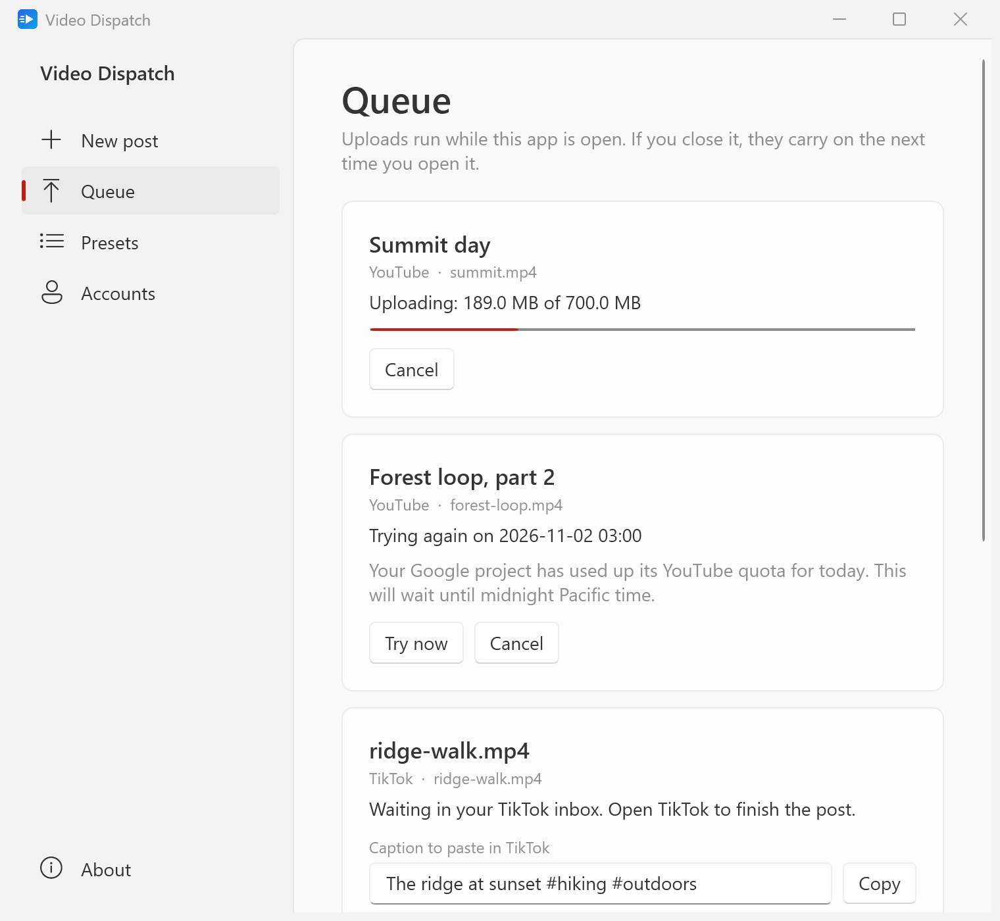
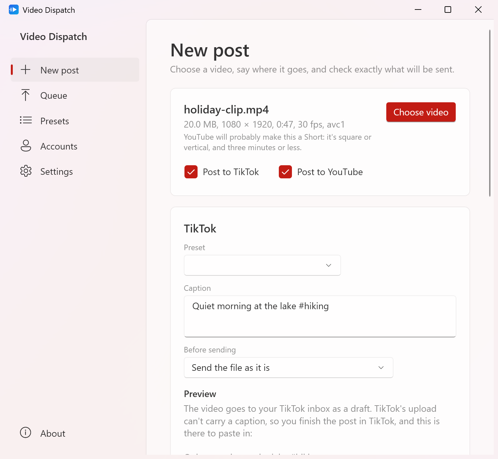
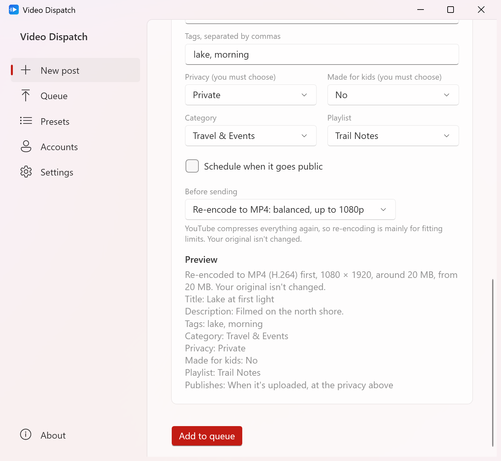
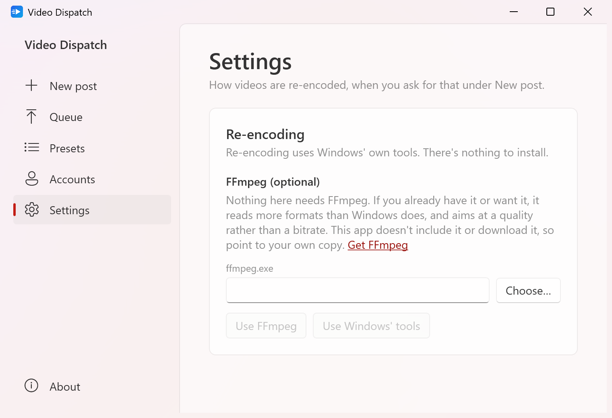
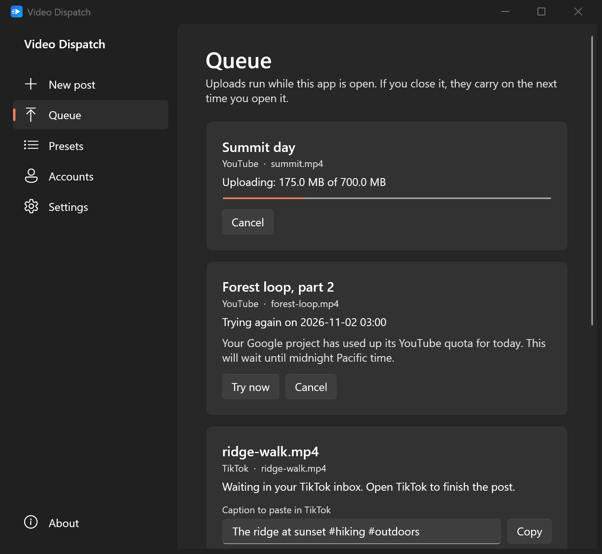
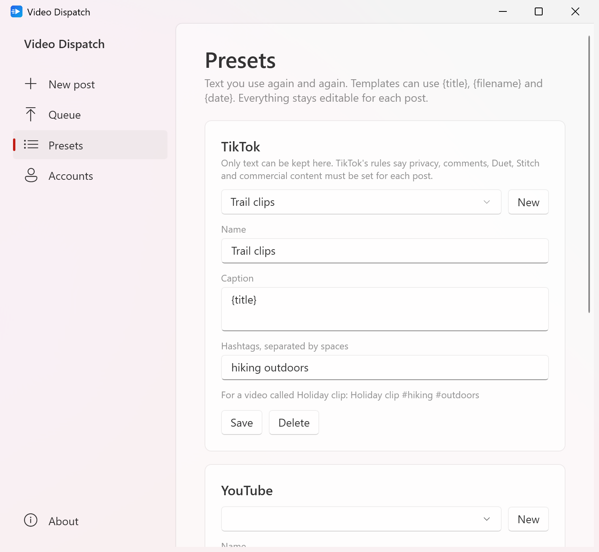
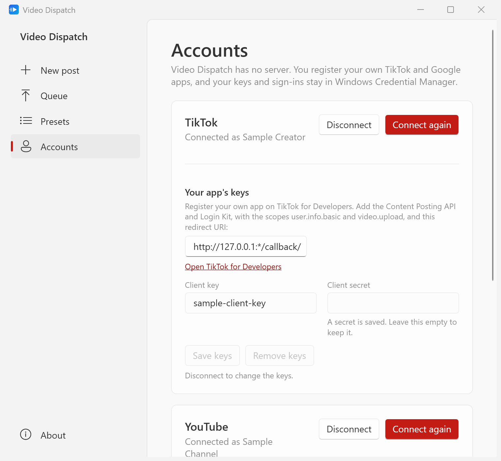

<p align="center">
  <a href="https://strongthium.com" title="Strongthium Labs"></a>
</p>

# video-dispatch

[](LICENSE)

`video-dispatch` is a Windows desktop app for uploading video to TikTok and YouTube, including YouTube Shorts: choose one video, write what goes with it, and queue it to both. It keeps a queue that survives restarts, resumes interrupted YouTube uploads, schedules YouTube videos, fills in text from your own presets, and can compress or re-encode a video to MP4 before sending it.

It runs on Windows 10 (version 2004 or later) and 11, is one file of about 7 MB with nothing to install, and has no server. You register your own TikTok and Google apps, and your videos go straight from your PC to them.

> [!WARNING]
> **This hasn't been run against real TikTok or Google accounts yet**, only against local servers built from their docs. TikTok may also refuse the app you register, which would leave only YouTube. See [What hasn't been tried](#what-hasnt-been-tried) and [Registering your apps](#registering-your-apps).



Each video is a job for each platform. Here one is uploading, one waits out YouTube's daily quota, and one sits in the creator's TikTok inbox with its caption ready to paste.

## A tour

The pictures are of made-up sample data (`video-dispatch --sample`): the channel, the videos and the accounts are invented, and nothing is sent anywhere.

### New post



Choose a video, and it says what's in it: size, picture size, length, frame rate and codec, and whether YouTube will probably make it a Short. That's only a prediction, because YouTube decides and has no setting for it: square or vertical and up to three minutes is a Short.

TikTok's inbox upload has no field for a caption. So the video arrives in your TikTok inbox as a draft, you finish the post in TikTok, and the caption you wrote here waits on the Queue page to paste in.



For YouTube you choose privacy and made for kids yourself each time, unless a preset chose them. YouTube treats a missing privacy as public, so nothing is queued without one. The preview is built from the same values that are sent, so it's exactly what YouTube gets. A scheduled video stays private until its time, even with the app closed.

### Compressing and re-encoding

Each platform has its own **Before sending** choice. It starts on sending the file as it is, and nothing is re-encoded unless you ask.

| | |
|---|---|
| **High quality** | an H.264 MP4 at the same picture size |
| **Balanced** | the same, at up to 1080p |
| **Smaller file** | the same, at up to 720p |
| **Fit a size** | as many megabytes as you say, with the picture made smaller too if the size calls for it |

Your original is never changed. The new file stays in the app's own folder until the platforms have it, and two platforms asking for the same thing share one file. An MP4 that wouldn't come out smaller is sent as it is, and the job says so. A video too big or in a format TikTok refuses can be queued if it's being made into something TikTok takes. The platforms compress everything again, so re-encoding is mainly for fitting limits, not for looking better.



Windows' own tools do this, so there's nothing to install, and nothing needs FFmpeg. If you'd rather use it, because it reads more formats and aims at a quality rather than a bitrate, **Settings** offers two ways:

| | |
|---|---|
| **Download FFmpeg** | fetches the stable Windows build, about 115 MB, checks it against its published checksum, unpacks only `ffmpeg.exe` and its licence into the app's folder, and checks that it runs and can make H.264 |
| **Use your own copy** | point at any `ffmpeg.exe` you already have |

FFmpeg isn't part of this project, and never ships with it: it arrives only when you press the button. [FFmpeg's own site](https://ffmpeg.org/download.html) offers only source code, and points Windows users to outside builders, so the button fetches the release build from [gyan.dev](https://www.gyan.dev/ffmpeg/builds/), one of the two it links to, under GPLv3. The checksum comes from that same site, so it catches a damaged download, not a tampered site.

While a downloaded copy is in use, the app asks gyan.dev for the newest version number about once a day. If there's a newer one, a dot appears beside **Settings**, and **Update FFmpeg** fetches it when you press it. It never installs one by itself. It doesn't ask anything if you use your own copy or Windows' tools. Going back to Windows' tools, or choosing your own copy, removes the downloaded one.

### Queue



Uploads run while the app is open, one at a time for each platform, so one stuck platform doesn't hold up the other.

| | |
|---|---|
| **Closing during an upload** | it warns first. YouTube uploads carry on from where they were the next time you open it. TikTok has no way to resume, so its uploads start over |
| **A connection that drops** | tries again with growing waits: 5 times for YouTube and 3 for TikTok, whose every new try may count against its limit |
| **A platform's limit** | the platform's queue waits it out: until midnight Pacific for YouTube's quota, and 24 hours for TikTok's 5 pending shares. **Try now** asks straight away |
| **A sign-in that ended** | that platform's queue pauses until you connect the account again, then carries on |
| **A file that changed after queueing** | fails instead of uploading a corrupt mix |
| **A video the platform already has** | is never sent again by hand. Trying again only checks on it, and **Stop following** says plainly that the video stays there |

The app stops asking about a TikTok draft after 7 days, and keeps the job so you can mark it posted. A video still processing after 3 days is marked failed, with a note to check on it there.

### Presets



Text you use again and again, with `{title}`, `{filename}` (without its extension) and `{date}` filled in. A misspelled variable is pointed out as you type, and blocks queueing rather than going out as written. Everything stays editable for each post.

TikTok presets hold only text, because TikTok's rules say privacy, comments, Duet, Stitch and commercial content must be set for each post.

### Accounts



One account per platform. Your keys are saved in Windows Credential Manager, a saved secret is never shown back, and **Disconnect** ends the sign-in at the platform too.

Adding videos to playlists is off unless you ask for it, because the YouTube permission it needs (`youtube.force-ssl`) also allows deleting videos, comments and captions. Turning it on later means connecting again.

## Using it

Take the `.exe` straight from [`public/`](public), which always holds the latest build: `video-dispatch-win-x64-needs-dotnet.exe`, about 7 MB, for Windows 10 (version 2004 or later) and 11 on x64 PCs. It runs on the [.NET 10 Desktop Runtime](https://dotnet.microsoft.com/download/dotnet/10.0) installed on the PC, which Microsoft Update keeps patched. Without it, Windows offers to download it. There's no release to download yet.

The program is small because it draws with what Windows and .NET already have: WPF, with Windows 11's own look (light or dark, in your accent colour). It adds no packages. About 6 MB of it is Microsoft's own library for reaching Windows' media tools, kept zipped inside the program and unpacked into memory only when a video is re-encoded.

1. [Register your apps](#registering-your-apps), once.
2. Under **Accounts**, enter each app's keys, save them, and press **Connect**. Your browser opens for you to approve.
3. Under **New post**, choose a video, fill it in, and press **Add to queue**.
4. For TikTok, open TikTok when the job says so, finish the post there, and paste the caption.

From the command line:

```
video-dispatch D:\Videos\walk.mp4     # opens New post on that video
video-dispatch --sample               # made-up accounts and jobs, no browser, no network, nothing saved
video-dispatch --theme dark           # light or dark, rather than following Windows
video-dispatch --page queue           # opens on new, queue, presets, accounts, settings or about
```

## Registering your apps

There's no server to hold a shared key, and a client secret can't be kept in open source, so each user registers their own apps. These steps come from each platform's docs, read on 2026-11-01. Their consoles change, and the steps haven't been walked through on a real account yet.

### TikTok

1. Sign up at [TikTok for Developers](https://developers.tiktok.com/). Click your profile icon, then **Manage apps**, then **Connect an app**, and choose the app's owner. TikTok advises an organization rather than an individual for real integrations.
2. Fill in the app icon (1024 x 1024), name, category and description. Under **Platforms**, choose **Desktop**, which asks for a website address.
3. Under **Products**, click **Add products**, and add **Login Kit** and the **Content Posting API**.
4. In Login Kit, add this redirect URI exactly. The `*` is a wildcard port, because the app listens on a random one:

   ```
   http://127.0.0.1:*/callback/
   ```

5. Under **Scopes**, add `user.info.basic` and `video.upload`.
6. Copy the **Client key** and **Client secret** from **Credentials** into **Accounts** in the app.
7. Apps created since September 2024 must verify their website, terms of service and privacy policy addresses. That's under **URL properties**, then **Verify properties**.
8. Under **App review**, explain how you use each product and scope, upload a demo video, and click **Submit for review**. An app must be approved for `video.upload`.

**TikTok may refuse this.** Its [Content Sharing Guidelines](https://developers.tiktok.com/doc/content-sharing-guidelines) say a utility tool for accounts you or your team manage isn't acceptable, and they don't cover apps that each user registers. If yours is refused, untick **Post to TikTok** and use YouTube alone.

TikTok also has a **Sandbox** mode, switched at the top of the app page, for trying things without review, on up to 10 accounts you own. Its docs say it offers no Content Posting API access for public videos, and don't say whether inbox uploads work. So that's worth trying, but it's not known to work.

### Google (YouTube)

1. In the [Google Cloud console](https://console.cloud.google.com/), create a project or choose one.
2. In the [API Library](https://console.cloud.google.com/apis/library), find **YouTube Data API v3** and enable it.
3. Set up the OAuth consent screen, with an external audience if you're asked. While the app's status is **Testing**, add your own Google account as a test user on the **Audience** page.
4. On the [Clients](https://console.cloud.google.com/auth/clients) page, click **Create client**, choose **Desktop app**, name it, and click **Create**. There's no redirect address to enter: a desktop client signs in through a local address on a random port.
5. Copy the client ID, and the secret if you like, into **Accounts** in the app. Google lists the secret as optional for desktop clients.

The app requests `youtube.upload` and `youtube.readonly`, and `youtube.force-ssl` only if you ask for playlists.

**Move it out of Testing.** While it's in Testing, Google ends your sign-in after 7 days, and you'd have to connect again each week. To stop that, click **Publish app** on the Audience page. Google's rules for a published app then apply:

- An app that hasn't been verified shows an "unverified app" warning at sign-in, and at most 100 people can ever sign in to it.
- Google says verification is optional for an app for your personal use with under 100 users, who may click through the warning.
- Google's docs conflict on whether uploads from an unverified project stay private. So the app compares the privacy YouTube reports with what you asked for, and warns if they differ.

A Google project gets 100 video uploads a day through YouTube's API, and its quotas reset at midnight Pacific. Your channel may have a daily limit of its own.

## What hasn't been tried

Everything has been tested against made-up platforms: 799 tests, including the whole flow from signing in to both platforms' uploads over real connections to [local servers](tests/VideoDispatch.Tests/EndToEnd/LocalPlatforms.cs) built from their docs. Those servers can only be as right as the docs. These haven't happened yet:

- A real sign-in or upload on TikTok or YouTube, or an app approval from TikTok.
- A real video from a phone, rotated, through **New post**. Reading video details has been tried on real files, but rotation only on hand-built ones.
- Re-encoding real footage. Both engines have really encoded test videos, including sideways ones, and **Fit a size** stayed under its limit on all of them, but those are made-up pictures. So how real footage looks, and how long a long video takes, are still to be seen.
- **Download FFmpeg** pressed in the real app. The same download code has fetched and run the real build from gyan.dev, but from a test program, not from that button.
- An edition of Windows without the media tools, such as N editions. Re-encoding there should say to install the Media Feature Pack or choose FFmpeg.
- An update from a real release, because there's no release yet. The check for one has run against GitHub, and the update itself against made-up downloads.

Details that only a real account can settle are in [`docs/platform-notes.md`](docs/platform-notes.md), which records what the code relies on from each platform's docs.

## About and updates

**About** (at the bottom of the side) says who makes `video-dispatch`, with links to Strongthium, and asks GitHub whether there's a newer version. If there is, **Update** downloads the release, checks it against the release's `SHA256SUMS`, replaces the program and starts it again. If the program's folder can't be changed without an administrator, it says so, and **What's new** leads to the release to download by hand. The checksums come with the release, so they catch a damaged download, not a tampered release.

GitHub is asked only when About is first shown, again if it's shown an hour later, or when **Check again** is pressed. `api.github.com` sees that the question came from your address, and which program and version asked.

## Your data

There's no server and no telemetry. Your videos and what you write go from your PC to TikTok and Google, under your own apps, and nowhere else. If you download FFmpeg, gyan.dev sees your address and this program's name and version, when you fetch it and at each check for a newer version. Nothing about your videos goes there.

| | |
|---|---|
| **Keys, sign-ins and the addresses of unfinished uploads** | only in Windows Credential Manager, never in a plain file. Access tokens stay in memory |
| **Jobs, presets and settings** | JSON files under `%LOCALAPPDATA%\video-dispatch`, with no secrets in them |
| **A downloaded FFmpeg** | under that same folder, if you asked for it |
| **Your videos** | read where they are, and never changed. A re-encoded copy stays under that folder until the platforms have it |

To remove it all, press **Disconnect** and **Remove keys** under **Accounts**, delete that folder, and delete the program.

## Building

You need Windows and the [.NET 10 SDK](https://dotnet.microsoft.com/download).

```
.\build.ps1                 # tests, then the program into public\  (or double-click build.cmd)
.\build.ps1 -Bump patch     # the same as a new version: 1.0.0 -> 1.0.1
```

`build.ps1` runs the tests (`-SkipTests` skips them), publishes the program, and replaces what's in [`public/`](public) with it, its `SHA256SUMS` and the `VERSION` it was built as.

The version is in [`VERSION`](VERSION), `major.minor.patch`, and every build reads it. `-Bump major|minor|patch` or `-Version 2.0.0` builds a new one, and `VERSION` is changed once that build has succeeded, so the version in the repository is always the one in `public/`.

For working on it:

```
dotnet build
dotnet test
dotnet run --project src/VideoDispatch -- --sample
```

| Folder | What's in it |
|---|---|
| [`src/VideoDispatch.Core`](src/VideoDispatch.Core) | the publishing library, with no UI: sign-ins, both upload clients, the queue, presets, reading video details, what re-encoding aims for, FFmpeg, updates |
| [`src/VideoDispatch.Editing`](src/VideoDispatch.Editing) | re-encoding with Windows' own media tools |
| [`src/VideoDispatch`](src/VideoDispatch) | the window (WPF, with its Fluent theme): New post, Queue, Presets, Accounts, Settings and About, and the made-up sample |
| [`tests/VideoDispatch.Core.Tests`](tests/VideoDispatch.Core.Tests) | tests of the library, some over real sockets to local servers |
| [`tests/VideoDispatch.Tests`](tests/VideoDispatch.Tests) | tests of what the screens do, and the end-to-end tests |
| [`docs/platform-notes.md`](docs/platform-notes.md) | what the code relies on from each platform's docs |
| [`public`](public) | the latest build, made by `build.ps1` |
| [`build.ps1`](build.ps1), [`build.cmd`](build.cmd), [`VERSION`](VERSION) | the builder, and the version it builds |

`master` holds the source. A push to `deploy` (a merge into it counts) runs [`.github/workflows/release.yml`](.github/workflows/release.yml), which:

1. runs the tests on Windows;
2. builds the x64 program, one `.exe`;
3. publishes release `v<VERSION>` with its zip and `SHA256SUMS`. A version is released once: to release again, raise it first (`build.ps1 -Bump patch`).

There's no `deploy` branch yet, so nothing has been released.

## More from Strongthium

Strongthium Labs also makes software for running your own servers and talking to your customers, at [strongthium.com](https://strongthium.com):

<table>
  <tr>
    <td width="64" align="center" valign="top">
      <a href="https://strongthium.com/linux-server-firewall"><picture><source media="(prefers-color-scheme: dark)" srcset="https://raw.githubusercontent.com/strongthium/.github/main/profile/icons/dark/guard.svg"></picture></a>
    </td>
    <td valign="top">
      <a href="https://strongthium.com/linux-server-firewall"><b>Strongthium Guard</b></a><br>
      <sub><b>Linux server firewall.</b> Locks down your Linux servers, reads their logs and shuts out whoever attacks them, within seconds.</sub>
    </td>
    <td width="64" align="center" valign="top">
      <a href="https://strongthium.com/self-hosted-mail-server"><picture><source media="(prefers-color-scheme: dark)" srcset="https://raw.githubusercontent.com/strongthium/.github/main/profile/icons/dark/mail.svg"></picture></a>
    </td>
    <td valign="top">
      <a href="https://strongthium.com/self-hosted-mail-server"><b>Strongthium Mail</b></a><br>
      <sub><b>Self-hosted mail server for Linux and Windows.</b> Receives, checks and sends your mail, and tells you exactly why it refused what it refused.</sub>
    </td>
  </tr>
  <tr>
    <td width="64" align="center" valign="top">
      <a href="https://strongthium.com/self-hosted-live-chat"><picture><source media="(prefers-color-scheme: dark)" srcset="https://raw.githubusercontent.com/strongthium/.github/main/profile/icons/dark/chat.svg"></picture></a>
    </td>
    <td valign="top">
      <a href="https://strongthium.com/self-hosted-live-chat"><b>Strongthium Chat</b></a><br>
      <sub><b>Self-hosted live chat for Linux and Windows.</b> A chat on your websites and text messages in one inbox, answered from Windows or a browser.</sub>
    </td>
    <td width="64" align="center" valign="top">
      <a href="https://strongthium.com/windows-ssh-client"><picture><source media="(prefers-color-scheme: dark)" srcset="https://raw.githubusercontent.com/strongthium/.github/main/profile/icons/dark/remote.svg"></picture></a>
    </td>
    <td valign="top">
      <a href="https://strongthium.com/windows-ssh-client"><b>Strongthium Remote</b></a><br>
      <sub><b>Windows SSH client.</b> SSH terminal, file manager, editor, server task manager, database client and remote desktop in tabs, in one program.</sub>
    </td>
  </tr>
</table>

## License

MIT, see [LICENSE](LICENSE).
